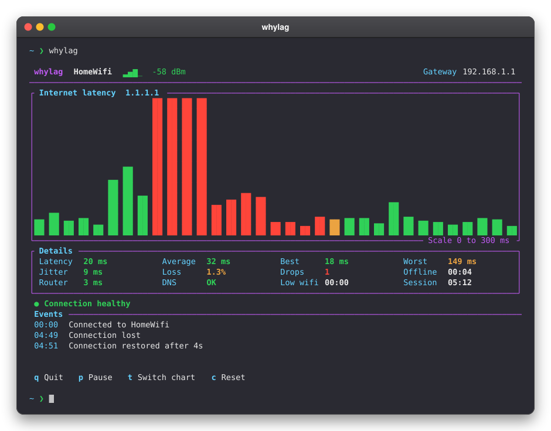

<div align="center">

<h3>whylag</h3>

see why your internet is lagging, live in your terminal

[](https://crates.io/crates/whylag)
[](https://github.com/ado11231/whylag/actions/workflows/check.yml)
[](https://www.rust-lang.org)
[](#install)
[](LICENSE)



</div>

## Install

```sh
cargo install whylag
```

Needs Rust 1.88+ and a terminal of at least 60×22. No admin rights needed.
On Linux, `ping`, `ip` & `getent` are required; install `iw` to see the network name.

## Usage

```sh
whylag                     # ping 1.1.1.1
whylag --target 8.8.8.8    # ping another address
whylag --log pings.csv     # save every sample to a new CSV file
```

| Key | Action |
| --- | --- |
| `q` / `Ctrl+C` | Quit & show the summary |
| `p` | Pause the screen (checks keep running) |
| `t` | Switch between internet & router chart |
| `c` | Reset stats |
