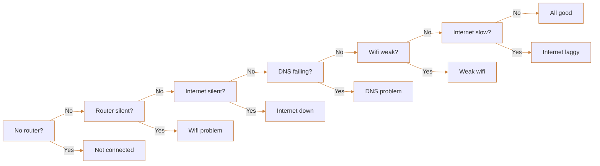
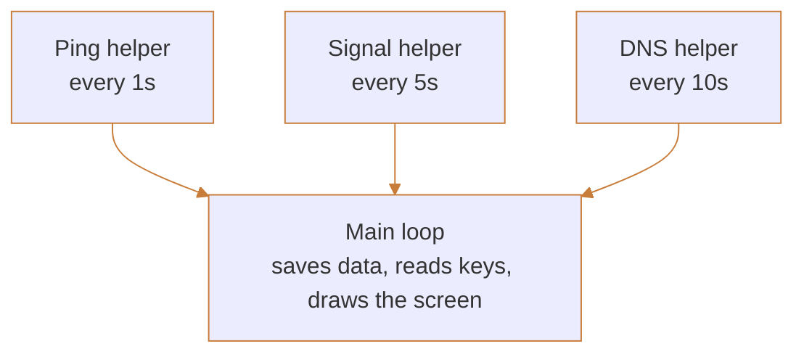

# Architecture

* What whylag does, how it works inside & what every source file does.
* What the screen looks like: [SCREEN.md](SCREEN.md). Every command & key: [COMMANDS.md](COMMANDS.md).

## Overview

* whylag shows how your wifi & internet are doing, live, in the terminal.
* Run `whylag`. It starts checking right away & the screen updates every second.
* Press `q` or `Ctrl+C` to quit. A short summary prints when you quit.
* Works on Mac & Linux. Needs no admin rights.

* **Tell you where the problem is.** Your wifi, your internet provider, or DNS.
* **Never freeze the screen.** Slow commands run on their own threads.
* **Plain words.** The status line says what is wrong in one sentence.

## Key Terms

| Term | Meaning |
| --- | --- |
| **Router** | The wifi box in your house. |
| **Ping** | A tiny message sent to a place to see how fast it answers. |
| **Ping time** | How long the answer took, in milliseconds (ms). Lower is better. |
| **Loss** | Pings that never came back. |
| **Jitter** | How much the ping time jumps around. High jitter means choppy calls & games. |
| **Drop** | The connection was lost: 3 failed pings in a row. |
| **DNS** | Turns names like `example.com` into addresses. When it fails, websites will not load. |
| **dBm** | How strong the wifi signal is. Closer to 0 is better. |

## Finding The Problem

* About every second, whylag pings two places. Slow checks can take longer:
* **Your router**, to check your wifi.
* **The internet** (`1.1.1.1`), to check your provider.

| What Happens | The Problem |
| --- | --- |
| Router slow or no reply | Your wifi. |
| Router fine, internet slow or no reply | Your internet provider. |
| Pings fine, name lookup fails | DNS. Websites will not load. |

## Status Messages

* Check in order. Show the first match.



| Check | Message | Color |
| --- | --- | --- |
| **No router?** No router found. | Not connected: no router found | Red |
| **Router silent?** Router not replying. | Wifi problem: can't reach router | Red |
| **Internet silent?** Internet not replying. | Internet unreachable: check your provider | Red |
| **DNS failing?** Name lookup failing. | DNS problem: websites may not load | Red |
| **Wifi weak?** Weak signal or router ping over 50 ms. | Weak wifi | Orange |
| **Internet slow?** Internet ping over 150 ms or recent loss. | Internet laggy | Orange |
| Every check says no. | All good | Green |

## The Bar Chart

* One bar every second. New bars appear on the right & push old ones left.
* Taller bar = slower ping. 300 ms or more fills the whole height.
* Bar color shows lost pings out of the last 10: none is green, 1 is orange, 2 or more is red.
* No reply = full red bar.
* Remembers the last 300 pings & shows as many as fit on screen.
* Press `t` to switch between internet & router.

## Colors

| Use | Color |
| --- | --- |
| Good | Green |
| Okay | Orange |
| Bad | Red |
| Titles & labels | Cyan |
| Highlights | Magenta |
| Less important text | Gray |

### Signal

| Signal | Bars | Color |
| --- | --- | --- |
| -60 or higher | 3 to 4 | Green |
| -61 to -70 | 2 | Orange |
| -71 or lower | 0 to 1 | Red |

### Ping

| Ping | Color |
| --- | --- |
| Under 50 ms | Green |
| 50 to 150 ms | Orange |
| Over 150 ms | Red |

## Stats

| Stat | Meaning |
| --- | --- |
| **Average ping** | Normal speed. |
| **Best & worst ping** | Fastest & slowest reply. |
| **Loss %** | Pings that never came back. |
| **Jitter** | The average change from one ping to the next. |
| **Drops** | Times the connection was lost. |
| **Time offline** | Total time with no connection. |
| **Weak signal time** | Time at 1 bar or less. |

## Event Log

* Add a timed line when:
* The connection is lost.
* The connection is back, with how long it was down.
* The signal drops to 1 bar or less.
* The signal recovers.
* You join a different network.
* DNS fails or recovers.

## Controls

| Key | Does |
| --- | --- |
| `q` or `Ctrl+C` | Quit & show the summary. |
| `p` | Pause the screen. |
| `t` | Swap internet & router bars. |
| `c` | Clear stats. |

| Option | Does |
| --- | --- |
| `--target <address>` | Ping a different address. |
| `--log <file>` | Save every ping to a CSV file. |

## Exit Summary

* Prints after the screen closes:

```
╭─ whylag summary ─────────────── 12 min ─╮
│                                         │
│   Average ping      38 ms               │
│   Best / Worst      21 ms / 410 ms      │
│   Loss              2.1%                │
│   Jitter            6 ms                │
│   Drops             3  (14s offline)    │
│   Weak signal       1m 20s              │
│                                         │
╰─────────────────────────────────────────╯
```

* Title & box border in magenta.
* Labels in cyan. Numbers colored with the same rules as the live screen.

## How It Runs



* Three helpers run side by side, so slow commands never freeze the screen.
* They send their results to the main loop.
* The main loop updates 4 times a second.
* External commands have time limits. Shutdown waits for running checks to finish.
* Event times show minutes & seconds since the stats were last cleared.
* On quit, the helpers stop, the terminal goes back to normal, then the summary prints.
* Use `ratatui::init()` & `ratatui::restore()` so the terminal is put back even after a crash.
* The DNS helper looks up `example.com`. If that fails, DNS is down.

## Mac & Linux

* Each system's code lives in its own file. Both files expose `read_network()`, `get_router()` & `ping_args()`.

| Task | Linux | Mac |
| --- | --- | --- |
| Signal | Read `/proc/net/wireless` | `system_profiler SPAirPortDataType` |
| Network name | `iw dev <wifi> link` | Same as signal |
| Router | `ip route` | `route -n get default` |
| Ping | `ping -c 1 -W 1` | `ping -c 1 -W 1000` |

### Reading Pings

* Find `time=` & take the number after it.
* No `time=` means the ping was lost.

### Mac Notes

* Don't use `airport`. Apple removed it.
* Don't use `wdutil`. It needs admin rights.
* `system_profiler` is slow, so check the signal every 5 seconds.
* If the network name says "redacted", show `Wi-Fi`.

## File Reference

```
whylag/
├── Cargo.toml
└── src/
    ├── lib.rs              shared modules & tests
    ├── options.rs          command-line options
    ├── command.rs          command deadlines & tool checks
    ├── main.rs             start, the main loop & keys
    ├── app.rs              all saved data
    ├── helpers.rs          starts the 3 helpers
    ├── ping.rs             runs ping & reads the time
    ├── stats.rs            loss, jitter & averages
    ├── status.rs           picks the status message
    ├── ui.rs               draws the screen
    ├── summary.rs          the exit summary
    ├── log.rs              the CSV file
    └── platform/
        ├── mod.rs          picks Mac or Linux
        ├── linux.rs        Linux commands
        └── macos.rs        Mac commands
```

### Libraries

| Crate | Used For |
| --- | --- |
| `ratatui` | The screen. Its built-in `crossterm` reads keys. |
| Standard library | Session timers & CSV timestamps. |
